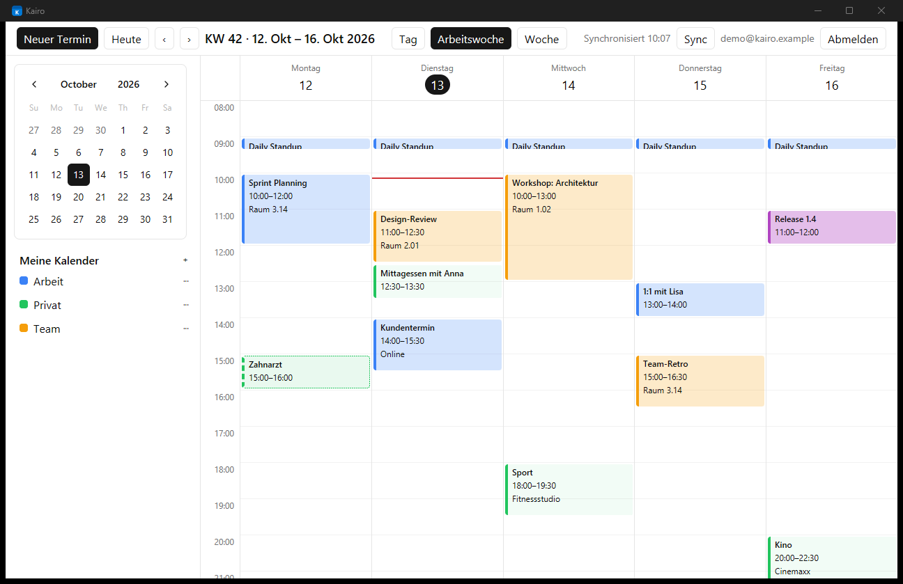
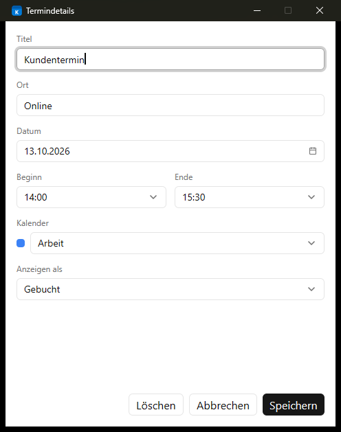
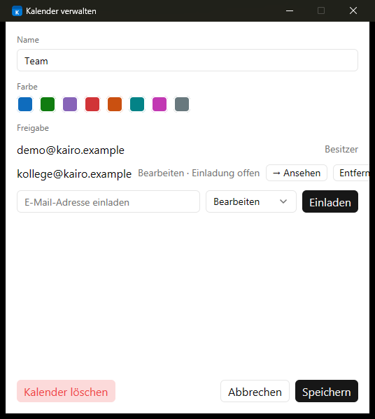
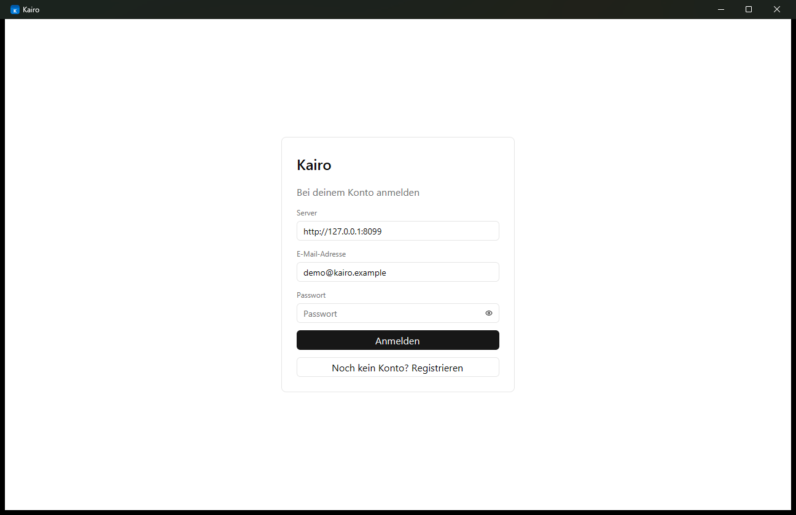

# Kairo

Ein schlanker, selbst gehosteter Kalender: native Desktop-App in Rust ([GPUI](https://www.gpui.rs/)) plus ein kleiner Sync-Server mit SQLite. Eigene Daten, eigener Server, keine Cloud von Dritten.



## Funktionen

- **Tag-, Arbeitswochen- und Wochenansicht** mit Monatsübersicht und Kalenderliste in der Seitenleiste
- **Mehrere Kalender** mit eigenen Farben, einzeln ein- und ausblendbar
- **Termine** mit Titel, Ort, Beginn/Ende, Kalender und Status (*Frei*, *Mit Vorbehalt*, *Gebucht*, *Abwesend*)
- **Sync zwischen Geräten** per Delta-Abgleich; Änderungen anderer Geräte erscheinen live über WebSocket
- **Offline nutzbar**: Daten liegen lokal im Cache und werden bei der nächsten Verbindung abgeglichen
- **Kalender teilen**: andere Konten per E-Mail einladen, mit den Rollen *Bearbeiten* oder *Ansehen*
- **ICS-Feed** pro Kalender zum Abonnieren in anderen Kalender-Apps
- **Tastenkürzel und Kontextmenüs** für die schnelle Bedienung
- Zugangstoken wird im Schlüsselbund des Betriebssystems gespeichert, Passwörter werden serverseitig gehasht

<table>
  <tr>
    <td></td>
    <td></td>
  </tr>
  <tr>
    <td align="center">Termindetails</td>
    <td align="center">Kalender verwalten und teilen</td>
  </tr>
</table>

## Schnellstart

Kairo besteht aus zwei Teilen: dem **Server** (`server/`) und der **Desktop-App** (Projektwurzel). Voraussetzung ist eine aktuelle [Rust-Toolchain](https://rustup.rs/) (Edition 2024).

### 1. Server starten

Mit Docker:

```bash
docker compose up -d --build
```

Der Server lauscht danach auf `127.0.0.1:8080`, die Daten liegen im Volume `kairo-data`. Für den Zugriff von außen gehört ein TLS-Reverse-Proxy davor (dann `KAIRO_TRUST_PROXY=1` setzen).

Ohne Docker:

```bash
cd server
cargo run --release
```

### 2. App starten

```bash
cargo run --release
```

Beim ersten Start Serveradresse (z. B. `http://127.0.0.1:8080`), E-Mail-Adresse und Passwort eingeben und über **Noch kein Konto? Registrieren** ein Konto anlegen.



## Server konfigurieren

Die Konfiguration erfolgt über Umgebungsvariablen:

| Variable | Standard | Bedeutung |
| --- | --- | --- |
| `KAIRO_ADDR` | `127.0.0.1:8080` | Listen-Adresse (im Docker-Image `0.0.0.0:8080`) |
| `KAIRO_DB` | `kairo.db` | Pfad der SQLite-Datei (im Docker-Image `/data/kairo.db`) |
| `KAIRO_REGISTRATION` | `open` | `open` oder `closed`; nach der Registrierung aller Nutzer auf `closed` stellen |
| `KAIRO_INVITE_CODE` | – | Wenn gesetzt, muss dieser Code bei der Registrierung angegeben werden |
| `KAIRO_TRUST_PROXY` | `0` | `1` nur hinter einem Reverse-Proxy, der `X-Forwarded-For` setzt |

Mit Docker Compose lassen sie sich direkt beim Start übergeben:

```bash
KAIRO_REGISTRATION=closed docker compose up -d
```

## Tastenkürzel

| Kürzel | Aktion |
| --- | --- |
| `Strg`+`N` | Neuer Termin |
| `Enter` / `F2` | Ausgewählten Termin öffnen |
| `Entf` / `Rücktaste` | Ausgewählten Termin löschen |
| `Strg`+`D` | Termin duplizieren |
| `Esc` | Auswahl aufheben, Fenster schließen |
| `Strg`+`T` | Zu heute springen |
| `Strg`+`←` / `Strg`+`→` | Vorheriger / nächster Zeitraum |
| `Strg`+`1` / `2` / `3` | Tag / Arbeitswoche / Woche |
| `F5` / `Strg`+`R` | Jetzt synchronisieren |
| `Strg`+`S` / `Strg`+`Enter` | Termin speichern (im Termin-Fenster) |

## Aus dem Quellcode bauen

```bash
cargo build --release                      # Desktop-App
cargo build --release --manifest-path server/Cargo.toml   # Server
```

Installierbare Pakete (macOS `.app`, Linux `.deb`) lassen sich mit [`cargo bundle`](https://github.com/burtonageo/cargo-bundle) erzeugen; die Metadaten stehen in `Cargo.toml`, Icons unter `assets/` und der Linux-Starter unter `packaging/`.

### Tests

Die meisten Tests laufen direkt mit `cargo test`. Die Integrationstests der App brauchen einen laufenden Server:

```bash
KAIRO_TEST_SERVER=http://127.0.0.1:8099 cargo test -- --ignored
```

## Projektstruktur

```
src/        Desktop-App (UI, Sync, Live-Updates, Login, Mitglieder)
server/     Sync-Server (axum + SQLite): Konten, Sync-API, WebSocket, Freigaben, ICS-Feed
assets/     App-Icons
packaging/  Desktop-Eintrag für Linux
docs/       Screenshots für dieses README
```

### Sync-Protokoll in Kürze

Jede Änderung (auch Löschungen als Tombstones) erhält eine global aufsteigende Revision `rev`. Clients holen Änderungen mit `GET /api/v1/sync?since=<rev>` und schreiben mit optimistischer Nebenläufigkeit: `PUT /api/v1/events/{id}?base_rev=<rev>` antwortet mit `409` samt aktueller Serverversion, falls ein anderes Gerät den Termin zuvor geändert hat. Über `GET /api/v1/ws` meldet der Server neue Revisionen sofort an verbundene Clients.
